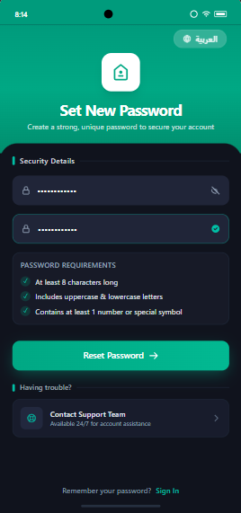
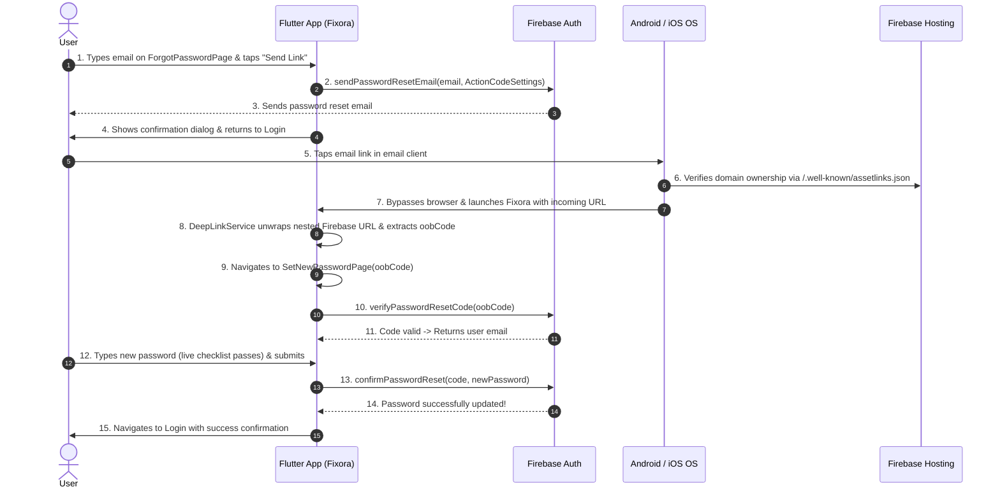

# Password Reset & Deep Link Feature Documentation

## 1. Feature Summary

This document explains the end-to-end implementation of the **Forgot Password & Set New Password** flow via **Firebase Authentication** and **Android App Links / iOS Universal Links**, designed using **Clean Architecture** and **BLoC (Freezed)**.

---

## 2. UI & Visual Design

<p align="center">
  
</p>

### Key UI Features:
1. **Brand Gradient Header**:
   - Teal brand gradient (`#00BFA6` to `#00897B`).
   - One-tap language switcher pill (`العربية` / `English`) with full RTL support.
   - White rounded container holding the Fixora logo.
   - Dynamic typography adjusting cleanly across various screen sizes.

2. **Security Details & Inputs**:
   - Two obscure-text password fields (`New Password` and `Confirm Password`).
   - Suffix visibility toggle icons (eye / eye-off).
   - Validation indicator showing real-time match state.

3. **Live Password Requirements Checklist**:
   Updates interactively on every keystroke:
   - [x] At least 8 characters long
   - [x] Includes uppercase & lowercase letters
   - [x] Contains at least 1 number or special symbol
   - Icon turns from muted grey dot to green animated checkmark as each requirement is satisfied.

4. **CTA Action Button**:
   - `Reset Password ->` disabled until all rules pass and both fields match.
   - Displays loading indicator during Firebase confirmation.

5. **Support & Navigation**:
   - Contact Support Team tile for user assistance.
   - Bottom link returning user to `Sign In`.

---

## 3. Complete Architecture & File Structure

```
lib/
├── config/
│   ├── di/
│   │   └── injection_container.dart        # Dependency injection (GetIt: DeepLinkService, UseCases, BLoCs)
│   └── routes/
│       ├── app_router.dart                 # GoRouter configuration & deep link interceptors
│       └── route_names.dart                # Centralized route paths (/forgot-password, /set-new-password)
├── core/
│   └── services/
│       └── deep_link_service.dart          # Deep-link listener (app_links), un-wrapper & oobCode extractor
├── features/
│   ├── auth/
│   │   ├── data/
│   │   │   └── repositories/
│   │   │       └── forgot_password_repository_impl.dart  # Firebase Auth calls (send email, verify code, confirm)
│   │   ├── domain/
│   │   │   ├── repositories/
│   │   │   │   └── forgot_password_repository.dart       # Abstract repository contract
│   │   │   └── usecases/
│   │   │       ├── send_reset_email_use_case.dart        # Step 1: Send reset email
│   │   │       ├── verify_reset_code_use_case.dart       # Step 2: Validate oobCode validity
│   │   │       └── confirm_password_reset_use_case.dart   # Step 3: Set new password
│   │   └── presentation/
│   │       ├── bloc/
│   │       │   ├── forgot_password_bloc.dart             # Request reset email BLoC
│   │       │   └── set_password_bloc.dart                # Set new password BLoC + live validation
│   │       ├── pages/
│   │       │   ├── forgot_password_page.dart             # User enters email & requests link
│   │       │   └── set_new_password_page.dart            # User enters new password & confirms
│   │       └── sections/
│   │           ├── set_password_hero_section.dart        # Brand teal hero with language switcher & logo
│   │           └── set_password_form_section.dart        # Inputs, live rules checklist, support tile
│   └── splash/
│       └── presentation/pages/splash_page.dart           # Guards cold-start routing & passes deep links
public/
└── .well-known/
    └── assetlinks.json                                   # Google Digital Asset Links for Android verification
```

---

## 4. End-to-End User Flow



---

## 5. Deep Link Mechanics: How It Works Under the Hood

### A. Why Links Wrap Inside `/__/auth/links`
When Firebase sends an email with `ActionCodeSettings(handleCodeInApp: true)`, Firebase encodes the URL into a tracking wrapper:
```
https://<project-id>.firebaseapp.com/__/auth/links?link=https://.../__/auth/action?apiKey=...&mode=resetPassword&oobCode=<SECRET_CODE>&continueUrl=...
```

### B. The Recursive `oobCode` Extractor
In [`lib/core/services/deep_link_service.dart`](file:///d:/feild-app/lib/core/services/deep_link_service.dart):
1. **Direct Parameter Check**: Checks `uri.queryParameters['oobCode']`.
2. **Nested `link` Check**: Parses the URL-encoded `link` parameter recursively.
3. **Nested `continueUrl` Check**: Unwraps fallback destination URLs.
4. **Decoded Regex Fallback**: Runs `[?&]oobCode=([^&]+)` over the full decoded string.

### C. The Splash & Cold-Start Race Condition Fix
- When the app is opened from a **cold start**, `SplashPage` runs an animation for 1.2 seconds.
- Previously, `SplashPage` called `context.go(RouteNames.login)` upon completion, overwriting the deep link.
- **Solution**: `DeepLinkService.pendingDeepLink` holds the target `/set-new-password?oobCode=...`. When `SplashPage` finishes its animation, it checks `pendingDeepLink` and forwards the user to `SetNewPasswordPage` instead of `Login`.

---

## 6. Platform Configuration

### Android (`android/app/src/main/AndroidManifest.xml`)
- Declares `android:autoVerify="true"` for domain validation:
```xml
<intent-filter android:autoVerify="true">
    <action android:name="android.intent.action.VIEW" />
    <category android:name="android.intent.category.DEFAULT" />
    <category android:name="android.intent.category.BROWSABLE" />

    <data android:scheme="https" android:host="fixora-app.web.app" />
    <data android:scheme="https" android:host="fixora-app.firebaseapp.com" />
    <data android:scheme="https" android:host="field-service-app-1145a.web.app" />
    <data android:scheme="https" android:host="field-service-app-1145a.firebaseapp.com" />
</intent-filter>
```

### Digital Asset Links (`public/.well-known/assetlinks.json`)
- Hosted on Firebase Hosting at `https://field-service-app-1145a.web.app/.well-known/assetlinks.json`.
- Contains the app package name `com.ziadahmed.feild_service_app` and its debug SHA-256 fingerprint:
  `8D:43:69:DE:F9:01:D8:16:23:CE:DF:60:BC:B8:6C:31:C4:2C:3F:99:A0:81:47:3B:80:E3:65:3B:B4:BF:3E:5D`.

---

## 7. Testing Guide

### Manual Testing with ADB
With the app installed on an emulator or physical device, run:

```bash
# Test full nested Firebase email URL format:
adb -s emulator-5554 shell am start -n com.ziadahmed.feild_service_app/.MainActivity -a android.intent.action.VIEW -d "https://field-service-app-1145a.firebaseapp.com/__/auth/links?link=https://field-service-app-1145a.firebaseapp.com/__/auth/action?apiKey%3DAIzaSyCAKkCfD-NeLyfMapnqw0uW3C3AzgMGYgE%26mode%3DresetPassword%26oobCode%3DTEST_CODE%26continueUrl%3Dhttps://field-service-app-1145a.web.app/set-new-password%26lang%3Den"

# Test direct HTTPS App Link:
adb -s emulator-5554 shell am start -n com.ziadahmed.feild_service_app/.MainActivity -a android.intent.action.VIEW -d "https://field-service-app-1145a.web.app/set-new-password?oobCode=TEST_CODE"
```

---

## 8. Pull Request Template / Summary

```markdown
### Description
Implements the complete "Forgot Password" and "Set New Password" flow using Firebase Authentication and App Links.

### Key Changes
- **UI & Presentation**: Built `SetNewPasswordPage` matching Figma design (brand gradient, Cairo font, dark theme, interactive requirements checklist, live match validation, Arabic & English translations).
- **Data & Domain**: Implemented `ForgotPasswordRepository`, `SendResetEmailUseCase`, `VerifyResetCodeUseCase`, and `ConfirmPasswordResetUseCase`.
- **Deep Linking**: Integrated `app_links` with `DeepLinkService` to handle cold-start and runtime deep links, unwrapping nested Firebase `/__/auth/links` parameters.
- **Routing**: Added routes for `/__/auth/links`, `/__/auth/action`, `/reset`, and `/set-new-password` in `GoRouter` with splash guard bypass.
- **Platform Setup**: Configured `AndroidManifest.xml` with `autoVerify="true"` and deployed `assetlinks.json` to Firebase Hosting.

### Verification
- `flutter analyze --no-fatal-infos` passes with 0 issues.
- Tested deep-link intent resolution and navigation via ADB and Firebase email link.
```
